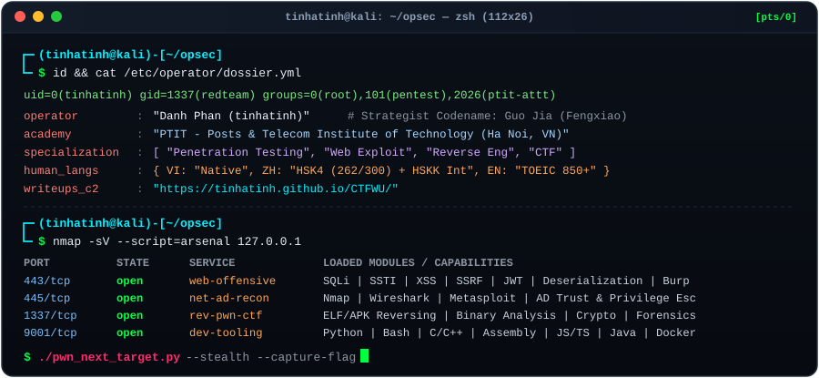
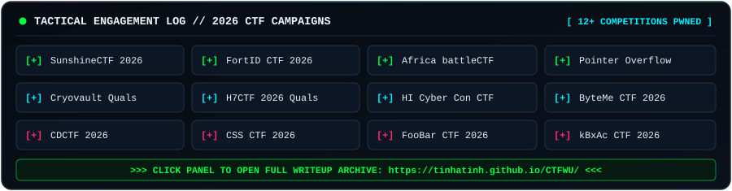
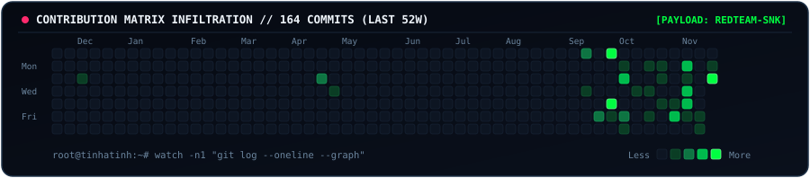

  <!-- CUSTOM ANIMATED RED-TEAM CYBER HUD BANNER -->
  

  <!-- DYNAMIC TERMINAL TYPING PROMPT -->
  

  <!-- UPLINK / COMMAND CHANNELS -->
  

    
    
    
    
    
  

---

### `⚡ [ 0x00 // OPERATOR DOSSIER & RECONNAISSANCE ]`

  

---

### `🛠️ [ 0x01 // OFFENSIVE ARSENAL & RUNTIME STACK ]`

  **`[ RED TEAM / SECURITY & EXPLOITATION TOOLKIT ]`**

  

    
    
    
    
    
    
    
    
    
    
  

  **`[ CORE LANGUAGES, INFRASTRUCTURE & DEV ENVIRONMENT ]`**

  

    
  

---

### `🚩 [ 0x02 // CTF ENGAGEMENTS & WRITEUP ARCHIVE ]`

  

---

### `🐍 [ 0x03 // CONTRIBUTION MATRIX INFILTRATION ]`

  

  
  <code>[ EOF // root@tinhatinh:~# logout — Breaking Systems Legally to Build Stronger Defenses ]</code>

